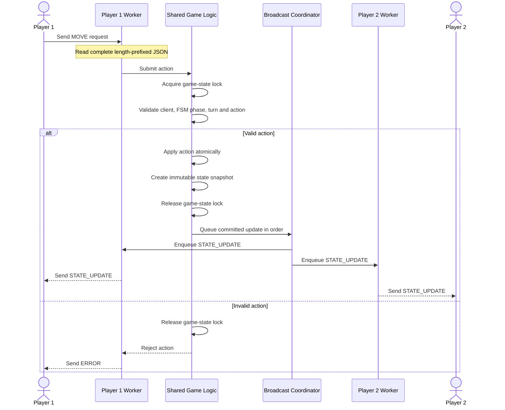

# Concurrency Design

## Chosen Concurrency Model: Multithreading

### Explanation:
**What:** My server would be using a thread-per client model. The server's main thread would accept an incoming TCP connection for the clients to make a dedicated worker thread for each. This would handle the communication with the client while the server could manage the game logic on its own authoratative state that it would then broadcast updates back to both clients.

**Why:** I chose multithreading for this project because I believe the clear owner's of each connection are a strength for this project. It can cleanly handle disconnections for both players, and it maintains a clear central event loop for the main game state. I also think it will allow me to be more flexible with changes in the future for how I want to handle the invalid requests or per-client work.

**Concerns:** I think there are several things I need to keep in mind for this. Race conditions will need to be handled for both workers, and I'll need to be wary of possible deadlocks. I will also need to manage the thread's lifecycles and the overhead the threads create.

### Thread Safety Analysis
**Deck and Cards:** The deck, draw position, player hands, and dealer hand. Two concurrent draw operations must never accidentally draw the same card or corrupt the deck position.

**Bet and Bankrolls:** Bet placement, available funds, payouts, and losses must be updated consistently. A player shouldn't be able to place an invalid bet or have a payout applied twice.

**Game Phase and Active Turn:** FSM state determines which actions are legal. The server must validate a request against the current state, not a stale state that another worker has already changed.

**Round Results and Scores:** Final scores and bankroll changes must be calculated once and communicated consistently to both players.

## Lock Acquisition Strategy: threading.Lock

**Acquiring and Releasing the Lock**
1. Receive the request first. A worker reads a complete length-prefixed JSON message from its socket without holding the game-state lock.

2. Acquire the lock before accessing mutable game state. Validate the client identity, current FSM phase, active turn, action type, and any relevant bet or balance constraints.

3. Apply the action atomically. Draw the card, update the hand, adjust the bet or bankroll where applicable, and advance the FSM as one logically consistent operation.

4. Prepare a state snapshot. Capture the information needed for the relevant response and broadcast, including the new phase and active player. The snapshot must not expose mutable objects that another thread can change afterward.

5. Release the lock.

6. Perform network sends outside the lock. Send responses and handle failed sends or disconnected clients.

**Notes:** Locks will be released before sending updates out of worry over a player being held hostage due to another's connection issues.

# Sequence Diagram

