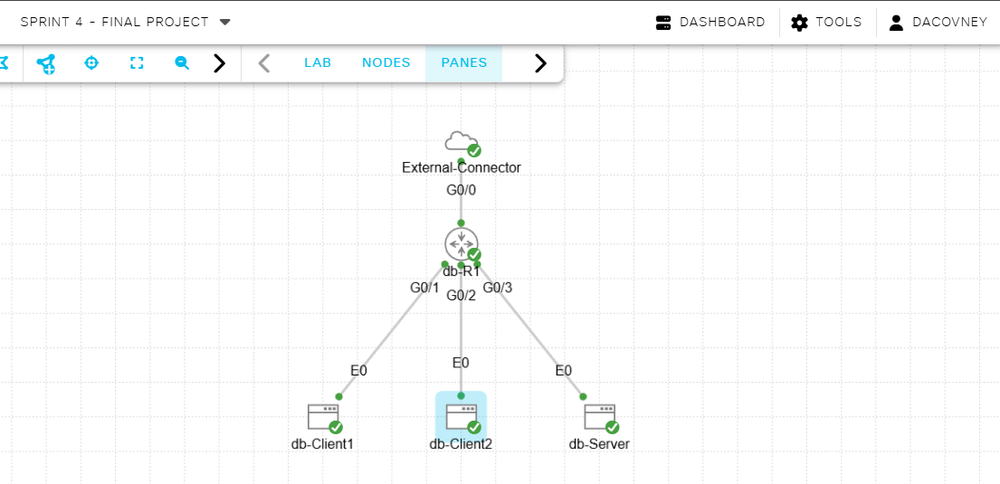
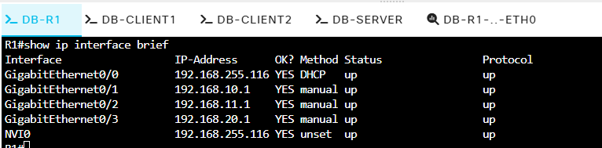
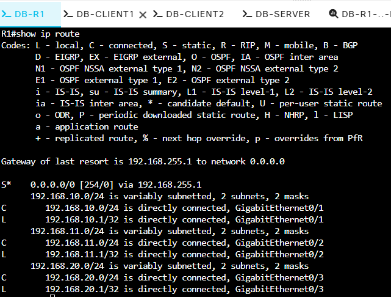
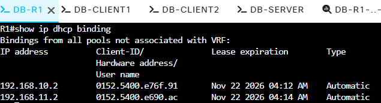
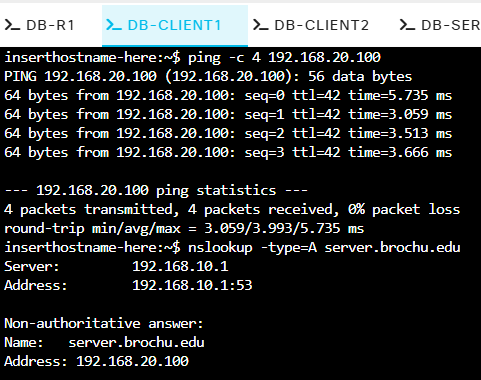
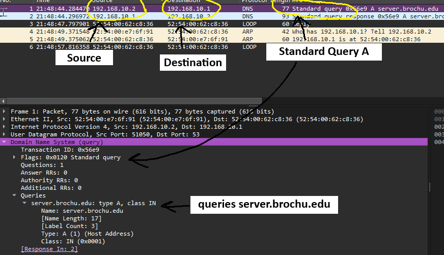
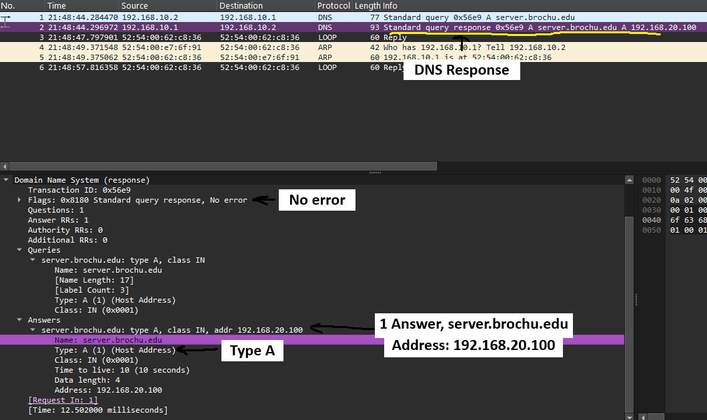

# Sprint 4: Network Deployment and Configuration Report

## 1. Project Overview

This project implements a multi-subnet network environment using Cisco Modeling Labs (CML). A single Cisco IOSv router (R1) provides inter-subnet routing, DHCP address assignment, DNS resolution, and Network Address Translation (NAT).

The network consists of two client subnets, one game server subnet, and an external network connection.

## 2. Network Topology

The network uses the following IPv4 addressing scheme:

| Network | Subnet | Router Interface | Gateway |
|---|---|---|---|
| Client 1 | 192.168.10.0/24 | Gi0/1 | 192.168.10.1 |
| Client 2 | 192.168.11.0/24 | Gi0/2 | 192.168.11.1 |
| Game Server | 192.168.20.0/24 | Gi0/3 | 192.168.20.1 |
| External Network | DHCP-assigned | Gi0/0 | 192.168.255.1 |

The game server uses a static address of `192.168.20.100`. The two clients receive their addresses dynamically through DHCP.

## 3. Router Configuration

R1 was configured with four active interfaces. The three internal interfaces provide gateway access to their respective subnets, while Gi0/0 connects to the external network through DHCP.

### Interface Status

The output of `show ip interface brief` confirms that all four interfaces are operational.

The external interface received the address `192.168.255.116` through DHCP. The internal interfaces use their assigned static gateway addresses.

### Routing Configuration

The routing table contains three directly connected internal networks and a default route through the external gateway.

The default route forwards traffic destined for external networks through `192.168.255.1`. No additional static routes were necessary for the internal networks because they are directly connected to R1.

## 4. DHCP Configuration

R1 provides DHCP services for both client subnets. Each pool distributes addresses within its respective network and supplies the appropriate default gateway and DNS server.

The resulting DHCP bindings were verified using `show ip dhcp binding`.

| Client | Assigned IP Address | Default Gateway | DNS Server |
|---|---|---|---|
| Client 1 | 192.168.10.2 | 192.168.10.1 | 192.168.10.1 |
| Client 2 | 192.168.11.2 | 192.168.11.1 | 192.168.11.1 |

Both clients successfully received automatic DHCP leases.

## 5. Connectivity Testing

Connectivity was tested between both client subnets and the game server.

### Client 1

Client 1 successfully received the address `192.168.10.2/24` and used `192.168.10.1` as its default gateway.

A ping test to the game server at `192.168.20.100` returned four successful replies with zero packet loss.

### Client 2

Client 2 successfully received the address `192.168.11.2/24` and used `192.168.11.1` as its default gateway.

A ping test to the game server at `192.168.20.100` also returned four successful replies with zero packet loss.

### External Connectivity and NAT

NAT overload was configured on R1 using the external interface Gi0/0. An access control list permits traffic from all three internal subnets.

Client 1 successfully pinged the external IP address `1.1.1.1`, receiving four replies with zero packet loss. This verified external connectivity through R1 and its NAT configuration.

## 6. DNS Configuration and Verification

R1 was configured as the DNS server for the internal network. A static host record maps:

`server.brochu.edu` → `192.168.20.100`

Client 1 successfully resolved the hostname using:

`nslookup -type=A server.brochu.edu`

The returned address matched the game server's static IPv4 address.

### Wireshark DNS Analysis

A Wireshark capture was collected during the DNS lookup. The capture demonstrates the complete DNS query and response exchange over UDP port 53.

**DNS Query**

Client 1 (`192.168.10.2`) sends an A-record query to R1 (`192.168.10.1`) requesting the IPv4 address associated with `server.brochu.edu`.

**DNS Response**

R1 responds to Client 1 with a successful DNS response. The response contains one A-record answer mapping `server.brochu.edu` to `192.168.20.100`. The DNS response status is `No error (0)`.

The complete packet capture is included as `sprint_4_dns_lookup.pcap`.

## 7. Conclusion

The Sprint 4 network deployment was successfully configured and tested. R1 provides inter-subnet routing, DHCP services, internal DNS resolution, and NAT for external connectivity.

Both clients successfully received DHCP addresses, communicated with the game server across subnets, and used the configured network gateways. DNS resolution correctly mapped the game server hostname to its static IPv4 address, and external connectivity was verified through NAT.

The included CML topology export, Wireshark packet capture, and screenshots provide evidence of the completed deployment and its functionality.
